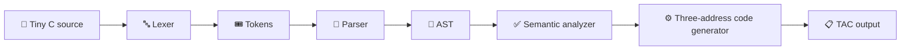

# 🧩 Mini Compiler for Tiny C

Welcome! This is a small, beginner-friendly compiler written in **Java**. It accepts a simple C-like language called **Tiny C** and converts it into **three-address code**, an easy-to-read intermediate form.

> 🎓 This project is made for learning compiler design. It supports a useful subset of C; it is not a full C compiler.

## 🌟 What does a compiler do?

Think of a compiler as a translator:

```text
Tiny C program  ──►  Compiler  ──►  Intermediate code
```

For example, Tiny C source:

```c
int total = 10 + 20;
print(total);
```

becomes:

```text
t1 = 10 + 20
total = t1
PRINT total
```

The compiler understands the program; it does not execute it.

## 🔄 Compiler pipeline

The project is divided into familiar compiler phases:



| Phase | Beginner-friendly meaning | Main class |
|---|---|---|
| Lexical analysis | Breaks characters into words and symbols | `Lexer` |
| Syntax analysis | Checks whether the words follow the grammar | `Parser` |
| AST construction | Builds a tree representing the program | `AstNode` |
| Semantic analysis | Checks meaning, names, and types | `SemanticAnalyzer` |
| Intermediate code generation | Produces simple instructions | `CodeGenerator` |

## ✨ Supported Tiny C features

Tiny C currently supports:

- `int` and `float` variables
- Variable declarations and initialization
- Assignments such as `score = 95;`
- Arithmetic: `+`, `-`, `*`, `/`
- Unary minus and parentheses
- Comparisons: `<`, `>`, `<=`, `>=`, `==`, `!=`
- Logical operators: `&&`, `||`, `!`
- `if`/`else` statements
- `while` loops
- `read(variable);` and `print(expression);`
- Single-line comments beginning with `//`
- Braces and semicolons

### 🧪 A complete Tiny C example

```c
// Print the numbers from 0 to 4
int i = 0;

while (i < 5) {
    print(i);
    i = i + 1;
}
```

## 🛠️ Requirements

- Java JDK 17 or newer
- A terminal such as macOS Terminal, Linux shell, or Windows PowerShell
- No Maven, Gradle, external libraries, database, or internet connection is required to compile the project

## ▶️ Build and run

Open a terminal in the `tiny-c-compiler` folder.

### 1. Compile the project

```bash
rm -rf out
mkdir -p out
javac -d out src/tinyc/*.java tests/TestRunner.java
```

### 2. Run the automated tests

```bash
java -cp out TestRunner
```

Expected result:

```text
Passed 8 tests.
```

### 3. Compile a Tiny C file

```bash
java -cp out tinyc.Main examples/basic.tc
```

The compiler prints the result of each major phase and then prints the generated intermediate code.

## 📋 Example compiler output

For `examples/loop.tc`, the important part of the output looks like this:

```text
i = 0
L1:
t1 = i < 5
IF_FALSE t1 GOTO L2
PRINT i
t2 = i + 1
i = t2
GOTO L1
L2:
```

Here:

- `t1` and `t2` are temporary values
- `L1` and `L2` are jump labels
- `IF_FALSE` leaves the loop when the condition is false
- `GOTO L1` repeats the loop

## 🚨 Error handling

The compiler stops before code generation when it finds a problem.

Example invalid program:

```c
int value = 1;
print(missing);
```

Example diagnostic:

```text
SEMANTIC error: undeclared variable 'missing'
```

This is useful because the compiler reports the problem instead of silently generating incorrect code.

## 📁 Project structure

```text
tiny-c-compiler/
├── src/tinyc/
│   ├── Main.java              # Command-line entry point
│   ├── Token.java             # Token types and source locations
│   ├── Lexer.java             # Characters → tokens
│   ├── Parser.java            # Tokens → AST
│   ├── AstNode.java           # AST records
│   ├── SemanticAnalyzer.java  # Meaning and type checks
│   ├── SymbolTable.java       # Declared variable tracking
│   ├── CodeGenerator.java     # AST → three-address code
│   └── CompilerError.java     # Compiler diagnostics
├── examples/                  # Sample Tiny C programs
├── tests/                     # Dependency-free tests
├── docs/                      # Architecture, grammar, and viva notes
└── README.md                  # This guide
```

## 🧠 Suggested study order

If you are preparing for a lab demonstration or viva, study the files in this order:

1. `Token.java` — learn what a token is.
2. `Lexer.java` — see how source characters become tokens.
3. `AstNode.java` — understand the program tree.
4. `Parser.java` — learn recursive descent and operator precedence.
5. `SymbolTable.java` and `SemanticAnalyzer.java` — understand declarations and types.
6. `CodeGenerator.java` — follow how AST nodes become TAC instructions.
7. `Main.java` — see how all phases are connected.

For more preparation, read [architecture.md](docs/architecture.md), [grammar.md](docs/grammar.md), and [viva-questions.md](docs/viva-questions.md).

## ⚠️ Current limitations

This project does not yet support:

- Functions or function calls
- Arrays, pointers, structs, or strings
- Preprocessor directives such as `#include`
- Block comments such as `/* ... */`
- Multiple nested symbol-table scopes
- Native machine-code generation

These are good ideas for future compiler-design experiments. 🚀

## 🔮 Possible future improvements

- Add nested scopes and functions
- Add an AST pretty-printer
- Add more precise semantic error locations
- Add constant folding and other simple optimizations
- Build a small virtual machine to execute the generated TAC
