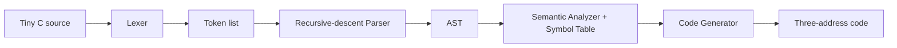

# Architecture

`Lexer` converts characters into tokens and reports illegal characters or malformed numbers. `Parser` consumes tokens using one method per grammar-precedence level, producing an AST instead of immediately emitting code. The AST is important because it stores the program structure and lets later phases inspect expressions consistently.

`SemanticAnalyzer` walks the AST, records declarations in `SymbolTable`, rejects undeclared names and invalid type combinations, and runs before code generation. `CodeGenerator` then walks the validated AST, creates deterministic temporaries (`t1`, `t2`, ...) and labels (`L1`, `L2`, ...), and emits assignments, `PRINT`, `READ`, conditional jumps, labels, and `GOTO` instructions.

Normal user mistakes are represented by `CompilerError`; `Main` prints the category and source position and exits nonzero. This version uses one top-level symbol table; braces group statements but do not create nested scopes.
